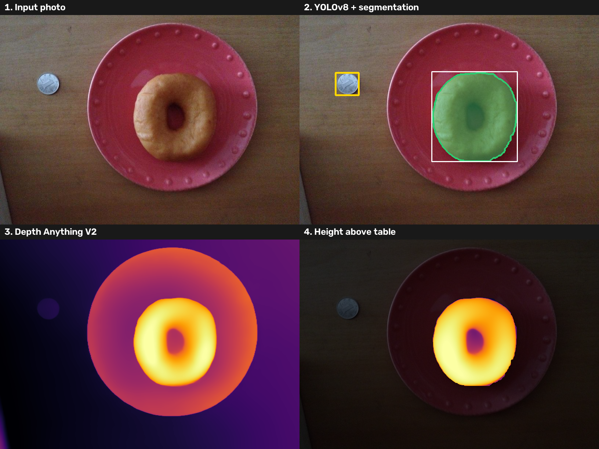
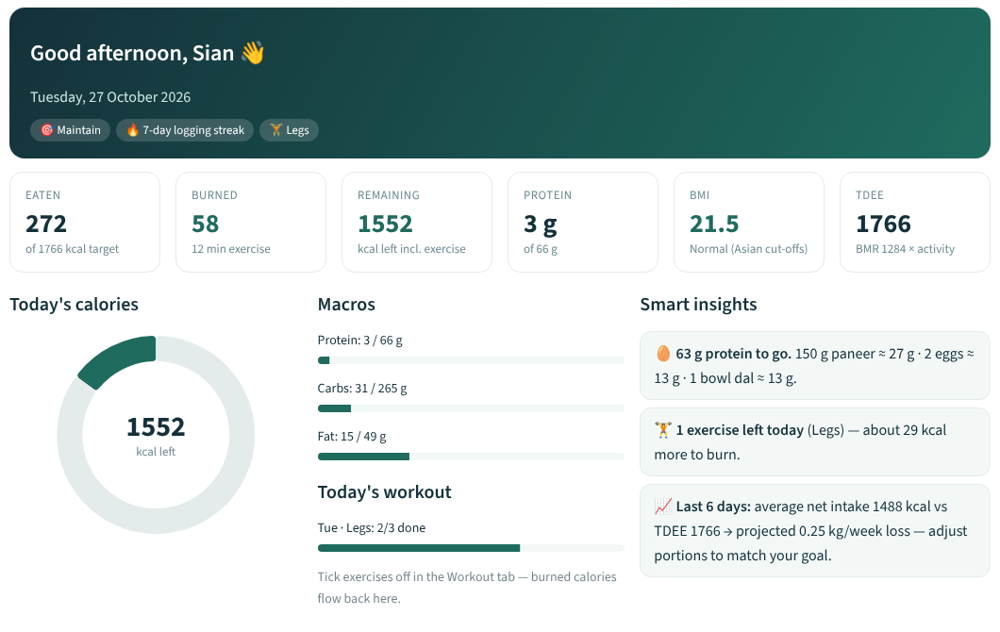

# FitSync – Workout Planner and Calorie Detector

**Depth-aware deep learning calorie estimation from a single food photo**, linked to personalised calorie targets, workout plans and a dashboard.

Most calorie apps recognise the food but *guess* the portion. FitSync **measures** it: photograph the meal from above with a coin beside the plate, and the app estimates each item's volume, grams and calories.



## How it works

```
photo + coin
  -> YOLOv8n (fine-tuned)        detects food items and the reference coin
  -> GrabCut                     exact outline (mask) of each food
  -> Depth Anything V2 (ViT-S)   relative depth of every pixel (ONNX, CPU)
  -> coin calibration            pixels per cm + camera distance (pinhole model)
  -> table-plane fit + height map
  -> volume = sum(height x pixel area)
  -> Gradient Boosting           corrects the volume (14 geometric + depth features)
  -> nutrition table             grams = density x volume -> kcal, protein, carbs, fat
```

Two extra detectors recognise **35 Indian dishes** (YOLO11n: 32 dishes; YOLOv8n: idli, dosa, chutney).

## Results (ECUSTFD, food items never seen in training)

| Method | Mass error (MAPE) | 5-fold CV |
|---|---|---|
| Typical-portion guess | 17.0% | 16.8% |
| 2D area + shape | 44.9% | 39.2% |
| Raw depth integration | 36.1% | 29.4% |
| Depth + ML (food-agnostic) | 20.6% | 14.5% |
| **Depth + ML + food prior (ours)** | **13.6%** | **11.5%** |

- 85% of estimates within ±20% of the real weight
- Foods with highly variable size (grape, mango, mooncake, kiwi): guess 44.5% → ours 21.6%
- Detectors (mAP@50): food + coin 0.97 · idli/dosa/chutney 0.90 · 32 Indian dishes 0.65

## Web app

Built with **Streamlit**:

- Log in / sign up (passwords hashed with PBKDF2), first-time profile setup
- **Analyse food** – upload or take a photo, see detection, depth and height maps, grams and calories
- **Profile & targets** – BMR (Mifflin–St Jeor), TDEE, calorie and macro targets, BMI
- **Workout** – goal-based weekly plan, calories burned (MET)
- **Dashboard** – eaten / burned / remaining, calorie ring, macros, insights, 7-day and weight trends



## Run it

Requires **Python 3.12** (3.10–3.12 work).

1. Download this repository.
2. Download the depth model **`da2_vits.onnx`** (95 MB, too large for this repository) from the **Releases** section of this repository and put it in the `models/` folder.
3. Windows: double-click `run_app_windows.bat`. Mac/Linux: `bash run_app_mac_linux.sh`.
   Or manually:
   ```
   pip install -r requirements.txt
   streamlit run app.py
   ```
4. Open http://localhost:8501 and log in with **demo / demo123**, or sign up.

Tip: photograph from directly above, 25–40 cm away, with a coin flat beside the plate, and choose that coin in the sidebar (₹10 = 27 mm). Test photos are in `demo_images/`.

## Deploy on Streamlit Community Cloud

1. Push this repository to GitHub (public) and attach `da2_vits.onnx` to a GitHub Release.
2. On share.streamlit.io: **Create app** → this repository → branch `main` → main file `app.py`.
3. **Advanced settings:** Python **3.12**, and under **Secrets** add
   `DA2_URL = "https://github.com/<your-username>/FitSync/releases/download/v1.0/da2_vits.onnx"`
4. Deploy. The depth model downloads automatically on first start.

Note: on free hosting, accounts and logged meals are reset whenever the app restarts.

## Project structure

```
app.py                  Streamlit web app
foodvol/core.py         detection, segmentation, depth, calibration, height map, volume pipeline
foodvol/regressor.py    Gradient Boosting volume correction
foodvol/nutrition.py    volume -> grams -> calories and macros
foodvol/planner.py      BMR, TDEE, targets, workout plans, calories burned
foodvol/dashboard.py    dashboard
foodvol/auth.py         login and sign-up
foodvol/store.py        per-user data storage
scripts/                dataset preparation, feature extraction, training and evaluation
colab/                  notebook for training the Indian food detector on a GPU
models/                 trained models (YOLO .pt, Gradient Boosting .joblib)
data/                   nutrition table (84 foods)
results/                metrics and figures
```

## Reproduce the results

```
git clone https://github.com/Liang-yc/ECUSTFD-resized-.git data/ECUSTFD
python scripts/prepare_dataset.py
yolo detect train data=data/yolo/ecustfd.yaml model=yolov8n.pt imgsz=416 epochs=12
python scripts/build_features.py --views T
python scripts/train_and_evaluate.py
```

## Datasets and references

- **ECUSTFD** – Y. Liang and J. Li, "Computer vision-based food calorie estimation: dataset, method, and experiment," arXiv:1705.07632, 2017
- **Depth Anything V2** – L. Yang et al., NeurIPS 2024, arXiv:2406.09414
- **YOLOv8 / YOLO11** – Ultralytics
- Indian food detection dataset (Roboflow Universe, CC BY 4.0) and Idli–Dosa dataset (GitHub)

## Team

Ananthu S · Arjun Krishna U · Gouri Krishna P R · Sian Mariam Suresh

Guide: Smt Arya Sreedhar, Assistant Professor · Sree Chitra Thirunal College of Engineering, Thiruvananthapuram
